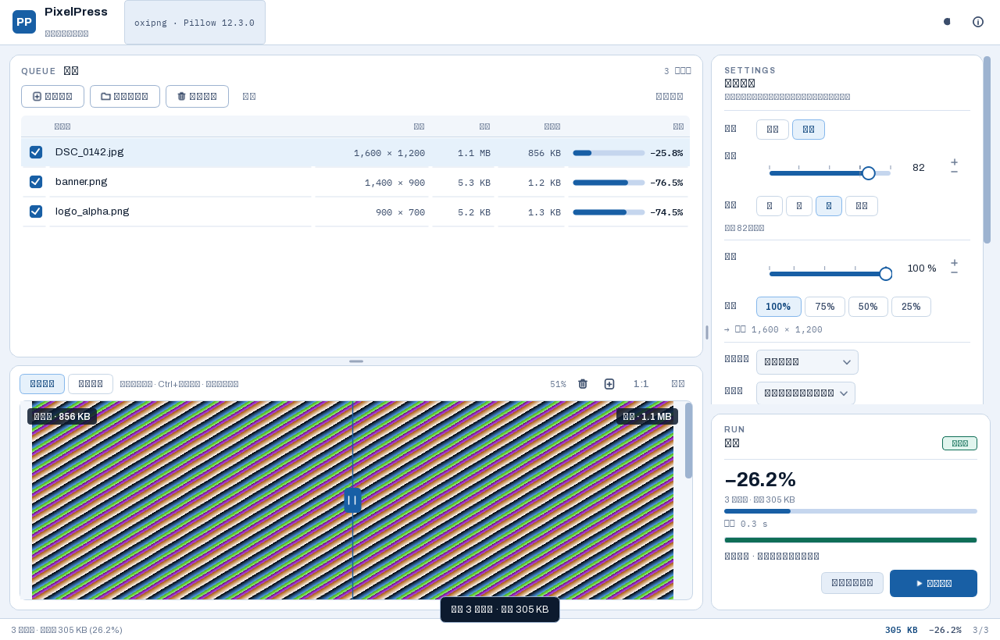

# PixelPress · 离线批量图片压缩

一个本机离线运行的图片压缩工具：多格式、可批量、无损与有损双模、按百分比等比缩放，界面按专业工具规格制作。打包为免安装 exe，不联网、不上传。



---

## 功能

- **多格式**：JPEG、PNG、WebP、AVIF、TIFF、GIF、BMP 读写；ICO、TGA、PPM 可读可原样重存；**HEIC/HEIF 只读**（可读入，输出落到可写格式）。
- **无损 / 有损双模**：按格式能力自动约束——AVIF 无无损、TIFF/BMP 无有损，界面会禁用不可用的那一侧并说明原因。
- **质量可调**：1–100 滑杆 + 低/中/高/极高预设；各格式按自己的标尺换算。PNG 有损为调色板量化（高预设起满 256 色），JPEG 高预设起使用 4:4:4 不丢色度；**照片的有损压缩建议选 WebP**。
- **等比缩放**：5–100% 百分比，纵横比锁定，100/75/50/25 快捷档，实时显示换算后的目标像素尺寸。
- **批量**：拖入文件或文件夹、多线程并行、逐文件状态与失败隔离、可中途取消（点击后立即显示「正在取消」，已开始的文件完成后停止）。
- **前后对比**：拖动中缝比较原图与压缩结果；默认适应宽度并用垂直滚动查看整张图，100% 时双向滚动；`Ctrl+滚轮` 缩放、滚轮上下滚动、双击复位。
- **自适应布局**：980×640 起可用；队列/预览与设置栏、队列/预览上下方向都可拖动分配空间；窗口变窄时队列出现水平滚动条，不裁掉「节省」列。
- **节省可视化**：每个文件一条节省量条形图，批次结束给出总节省大数字。
- **深色 / 浅色双主题**，字体随包内置，任何机器上都是设计的样子。

## 实测压缩效果

数据来自 `scripts/benchmark_codecs.py`（本机 Pillow 12.3.0 / oxipng 10.2.1）：

| 场景 | 结果 |
|---|---|
| WebP 无损 vs PNG 无损（UI 截图） | 502 B vs 5,849 B，**小 91%**，且逐位无损 |
| oxipng 重压缩 PNG 无损 | 照片 **−11.2%**，图形 **−75.5%** |
| JPEG 视觉无损（沿用原量化表） | 390 KB → 339 KB（−13%），PSNR 79.7 dB |
| JPEG 有损 q75 4:2:0 | 1.1 MB → 85 KB（−92%），PSNR 39.6 dB |

**无损模式优先选 WebP**——大多数情况下它同时赢过 PNG 的体积和保真度。

## 运行

开发态：

```bash
pip install -r requirements.txt
python scripts/fetch_fonts.py     # 首次拉取随包字体（OFL）
python PixelPress.py              # 启动界面
python PixelPress.py --headless   # 引擎自检，不打开窗口
```

打包：

```bash
python -m PyInstaller --clean --noconfirm PixelPress.spec
```

产物在 `dist/PixelPress/`，双击 `PixelPress.exe` 即可（约 120 MB，免装 Python 与任何运行时）。

## 快捷键

| 键 | 作用 |
|---|---|
| `Ctrl+O` / `Ctrl+Shift+O` | 添加文件 / 添加文件夹 |
| `Ctrl+Enter` | 开始压缩 |
| `Esc` | 取消 |
| `Delete` | 移除选中行 |
| `Ctrl+1` / `Ctrl+2` | 切到无损 / 有损 |
| `Ctrl+D` | 切换深色主题 |
| `Ctrl+` `+` / `-` / `0` | 预览放大 / 缩小 / 复位 |

## 目录结构

```
app/
├── main.py              入口（GUI / --headless 分派）
├── cli.py               打包自检（非用户级 CLI）
├── core/                纯 Python 引擎，零 Qt 依赖，可单测
│   ├── formats.py       格式注册表与能力位
│   ├── planner.py       模式/质量/力度 → 编码参数的唯一决策点
│   ├── pipeline.py      解码 → 方向烘焙 → 缩放 → 编码 → 校验 → 原子写盘
│   ├── naming.py        命名规则、冲突策略、原地覆盖保护
│   ├── encoders/        Pillow 全格式 + oxipng（PNG 无损增强）
│   ├── imaging.py       可选解码器注册（HEIC）
│   ├── settings_store.py 设置持久化（PIXELPRESS_SETTINGS_DIR 可覆盖）
│   └── paths.py         冻结/源码双模式的资源定位
└── ui/                  theme / fonts / icons / widgets / queue_model /
                         preview / panels / workers / ui_logic / main_window
scripts/
├── benchmark_codecs.py  编解码能力与压缩率实测
├── fetch_fonts.py       拉取随包 OFL 字体
├── ui_preview.py        离屏 / 实机像素审计 + 截图
├── verify_bundle.py     打包产物取证（TOC 模块名、资源、体积）
└── verify_live_window.ps1  实机启动与窗口截图
```

## 测试

```bash
python -m pytest tests -q          # 138 passed, 3 skipped（跳过项为刻意不可用的格式组合）
python scripts/ui_preview.py --platform real     # 像素审计（含缩放/滚动/取消状态）+ 截图
python scripts/verify_bundle.py                  # 需先打包（读 build/ 下的 TOC）
```

## 设计说明

界面方向为「Fluent 工具」：冷调蓝灰亚克力画布、深墨蓝文字、单一蓝紫信号色，层叠卡片与圆角作为基本视觉语汇——它是 Windows 11 的原生设计语言，让工具读起来像系统的一部分而不是外来样式。数值全部使用等宽字体以便扫读，节省量用条形图表达长度而非数字。

交互性能上，所有自绘组件（滑杆、队列行、预览对比）的颜色都走 `theme.color_for` 的模块级缓存（主题切换才失效），预览的字幕角标烘焙为位图缓存，主题切换只对顶层窗口做 unpolish/polish——这三层是拖动对比中缝与切换主题不再卡顿的原因。

完整技术方案、能力矩阵与设计令牌见 [docs/技术方案.md](docs/技术方案.md)。

## 已知边界

1. **JPEG 无比特级无损**：`quality="keep"` 保留原量化表并优化熵编码，实测 79.7 dB，视觉不可辨但非逐位相同。界面文案严格写「视觉无损」。
2. **AVIF 无无损模式**：Pillow 12 未暴露 libavif 的 lossless，界面禁用该组合。
3. **动图跳过**：GIF/WebP 多帧不重编码，队列中标注原因后跳过。
4. **HEIC 仅读不写**：写回 HEIC 涉及额外授权考量，输出侧自动落到可写格式。
5. **中文依赖系统字体**：界面用随包 Archivo + IBM Plex Mono，中文走系统微软雅黑 UI（不打包 CJK 字体以省 10+ MB）。
6. **PNG 有损只能做调色板量化**：最多 256 色，平滑的照片仍可能出现轻微色带；带透明通道的 PNG 会保留完整 alpha。照片的有损压缩优先选 WebP/JPEG，界面在 PNG 有损模式下也会给出该提示。

## 许可

代码为本项目自有。随包分发的第三方组件及其许可：

- **oxipng** — MIT
- **Archivo**、**IBM Plex Mono** — SIL Open Font License 1.1（许可原文见 `app/assets/fonts/LICENSE-*.txt`）
- **Pillow** — MIT-CMU；**pillow-heif / libheif** — BSD-3；**PySide6 / Qt** — LGPL-3
